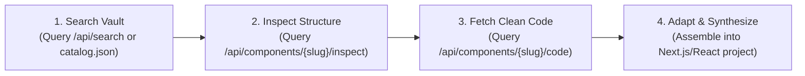

# Framer Craft Vault: Human-Art UI/UX Intelligence

The Framer Craft Vault gives agents taste, kinetic evidence, and production-ready artisanal component code.
It is the primary **Source of Truth** for high-craft UI/UX, preventing generic "AI slop" (sterile 3-column card layouts, flat `0.3s ease` transitions, default purple gradients, and cookie-cutter templates).

The vault holds **900+ award-winning, human-designed components** from Awwwards, FWA, and Framer Gallery winners.

---

## 1. Live Intelligence Endpoints

When internet access is available, use these fast REST endpoints for live querying and code retrieval:

| Endpoint | Method | Purpose |
| :--- | :--- | :--- |
| `https://jishnupg-opencode-cli.hf.space/preview/3000/api/dna` | `GET` | Codified motion presets, typography ratios, and surface tokens. |
| `https://jishnupg-opencode-cli.hf.space/preview/3000/api/categories` | `GET` | List all 16 categories with item counts and samples. |
| `https://jishnupg-opencode-cli.hf.space/preview/3000/api/catalog?limit=100` | `GET` | Paginated token-efficient index of components with titles & sizes. |
| `https://jishnupg-opencode-cli.hf.space/preview/3000/api/search?q={query}` | `GET` | Search by keyword or trait (e.g. `accordion`, `spring`, `shader`, `slider`). |
| `https://jishnupg-opencode-cli.hf.space/preview/3000/api/components/{slug}/inspect` | `GET` | Deep inspection of component props, dependencies, features, and springs. |
| `https://jishnupg-opencode-cli.hf.space/preview/3000/api/components/{slug}/code?raw=true` | `GET` | Clean standalone TypeScript/React code ready for pasting. |
| `https://jishnupg-opencode-cli.hf.space/preview/3000/api/recommend?use_case={goal}` | `GET` | Recommendations for `hero`, `landing`, `pricing`, `accordion`, `cards`, `buttons`. |

*Offline fallback: Consult `catalog.json` and `craft_dna.json` in this skill directory if the cloud API is unreachable.*

---

## 2. Non-Negotiable Human-Art Directives

1. **Never Generate Generic AI Slop**:
   - ❌ NO flat linear transitions (`transition: all 0.3s ease`).
   - ❌ NO cookie-cutter 3-column cards with centered generic Lucide icons.
   - ❌ NO default purple-to-blue linear gradients on plain dark backgrounds.
   - ❌ NO generic Inter 16px with `letter-spacing: 0`.

2. **Mandatory Spring Physics (From Vault DNA)**:
   Always use Framer Motion springs with calibrated mass and damping:
   - **Snappy Controls** (Buttons, Badges, Toggles):
     ```ts
     const snappySpring: Transition = { type: "spring", stiffness: 320, damping: 28, mass: 0.8 };
     ```
   - **Fluid Layouts** (Accordions, Expandable Cards, Modals):
     ```ts
     const fluidAccordion: Transition = { type: "spring", stiffness: 260, damping: 34, mass: 1.0, restDelta: 0.05 };
     ```
   - **Editorial & Hero** (Image Reveals, Large Text Slides, Parallax):
     ```ts
     const editorialSlow: Transition = { type: "spring", stiffness: 140, damping: 22, mass: 1.2 };
     ```
   - **Magnetic Elements** (Cursor followers, floating badges):
     ```ts
     const magneticSpring: Transition = { type: "spring", stiffness: 400, damping: 30, mass: 0.5 };
     ```

3. **Typographic Tension & Hierarchy**:
   - Large display headlines MUST use tight negative tracking (`letter-spacing: -0.04em` to `-0.055em`) and condensed line-height (`1.05em` to `1.12em`).
   - Micro-meta labels MUST use uppercase monospace (`font-family: 'JetBrains Mono', monospace`, `font-size: 11px`, `letter-spacing: 0.12em`).
   - Use fluid responsive clamps (`fontSize: clamp(2.5rem, 5vw, 4.5rem)`).

4. **Surface Treatment & Liquid Light**:
   - Double-inset borders: `box-shadow: inset 0 1px 1px 0 rgba(255, 255, 255, 0.15)`.
   - Frosted Glass: `backdrop-filter: blur(20px); background: rgba(19, 18, 16, 0.75); border: 1px solid rgba(255, 255, 255, 0.08);`.
   - Directional spot glows and noise textures instead of flat gray borders.

---

## 3. Four-Step Agent Workflow

Whenever instructed to create or polish a webapp, landing page, or UI component:



### Step 1: Query the Vault for Primitives
Before writing UI from scratch, query the API or `catalog.json` for matching human-designed primitives:
- Need an accordion? Fetch `fold-rows`, `reel-accordion`, or `country-accordion`.
- Need a hero showcase? Fetch `diagonal-slideshow`, `trailmark-video-hero`, or `spatialwave`.
- Need interactive cards? Fetch `cascade-card-slider`, `feature-ribbon-cards`, or `pixel-flip-card`.
- Need buttons? Fetch `liquid-blob-button` or `frostedglass-button`.

### Step 2: Inspect Props & Interfaces
Inspect the component structure to know what props to pass:
- Check required items, image URLs, titles, and callback functions.
- Notice any custom canvas or SVG elements.

### Step 3: Fetch the Code
Download the standalone `.tsx` code via `/api/components/{slug}/code?raw=true` or read from the local vault repository.

### Step 4: Adapt & Compose
- Replace hardcoded demo text with real application data.
- Ensure all Framer Motion components wrap in `"use client"` if using Next.js App Router.
- Combine multiple primitives into a unified design layout matching the color palette and typography rules from `craft_dna.json`.
